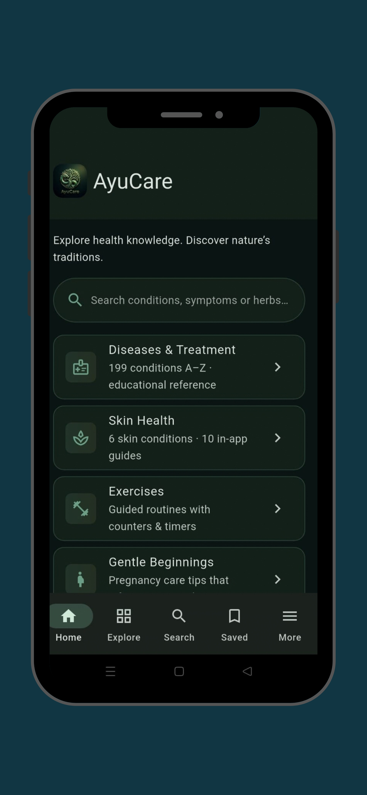
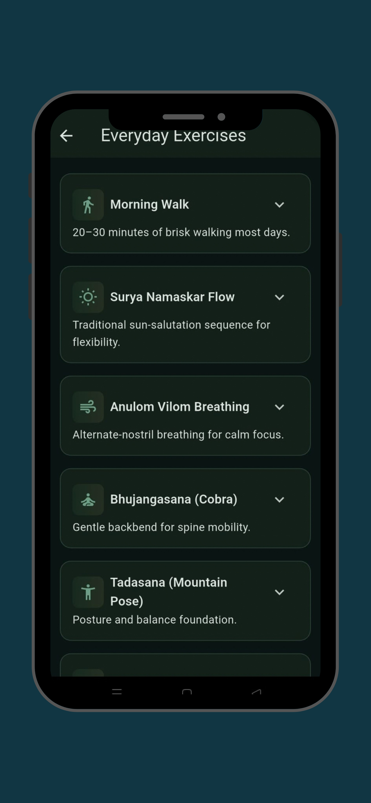
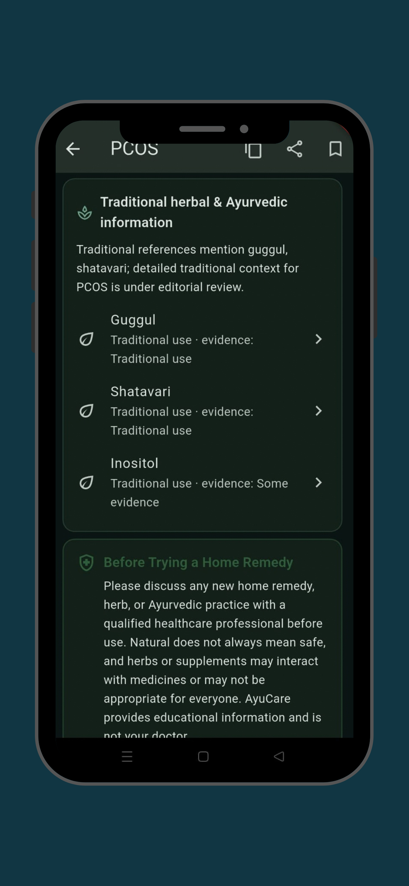
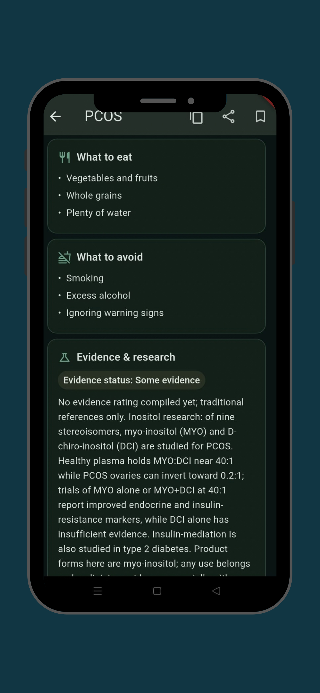
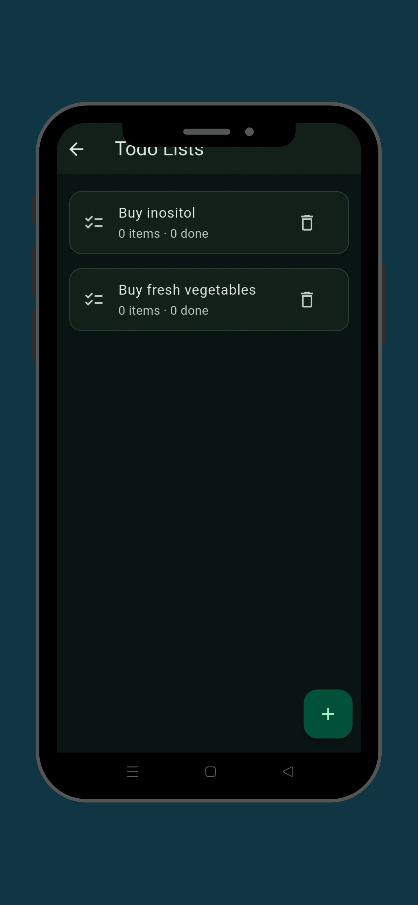
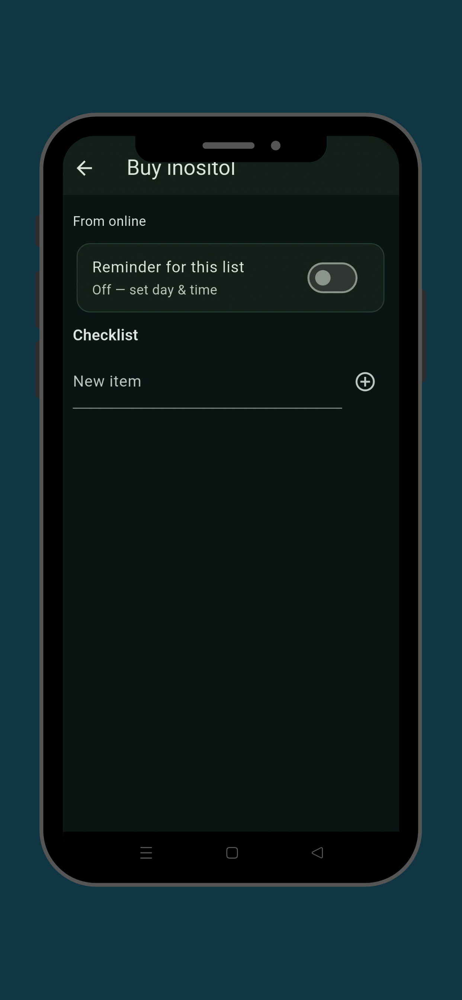
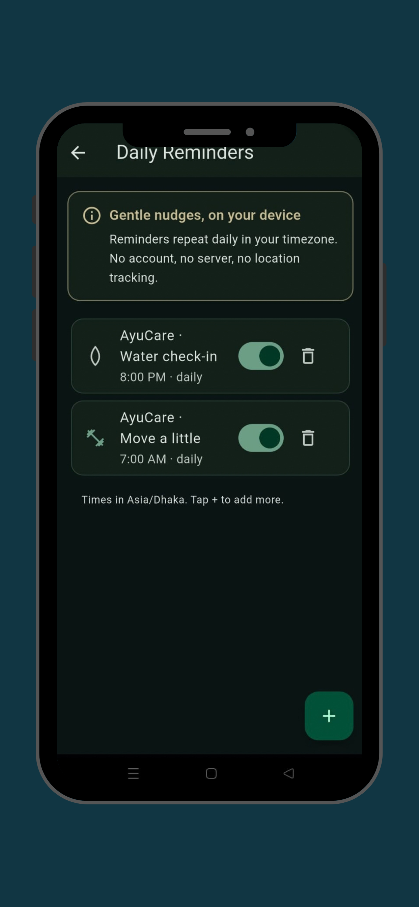

# AyuCare — Health & Ayurveda

  

  
  
  

AyuCare is an educational health and Ayurveda reference app for Android. It ships its entire content library offline — conditions, herbs, products, research notes — and runs with no backend, no account, and no analytics.

**Google Play:** https://play.google.com/store/apps/details?id=com.xeloxy.ayucare
**Website:** https://ayucare.my.canva.site/

## What's inside

- **Condition library** — 199 conditions with Ayurvedic and lifestyle reference entries, organized by category tags.
- **Herb & product catalogs** — herb reference plus a catalog of 60 global wellness products with category tags and availability notes.
- **Research notes** — plain-language summaries of published research (for example, inositol for PCOS, ovarian cysts and insulin resistance), with sources.
- **Lab tests card** — quick reference for common lab tests.
- **Daily reminders** — up to 8 on-device reminders in the device's timezone, plus todo lists with one-shot reminders. No server, no account, no location permission.

## How it's built

- **Flutter / Dart**, null-safe, `flutter_lints`, no external state-management framework.
- **Content-driven** — the catalogs live in `assets/content/*.json` (`conditions.json`, `herbs.json`, `products.json`, `sources.json`).
- **Local-first** — `shared_preferences` for settings, `flutter_local_notifications` + `timezone` for reminders, `url_launcher` and `share_plus` for links and sharing.
- **No Firebase, no ads, no affiliate links** in this build — the catalog is informational.

## Release engineering

- Production signing reads `android/key.properties` at build time; the keystore and that file live **outside the repository** and are git-ignored (`android/.gitignore` + root `.gitignore`).
- `docs/APP_IDENTITY.md` records the upload certificate SHA-256 and key history.
- `docs/` also carries the design system, architecture notes, content model, build and test reports, and the Play Store compliance checklist.

## Screenshots

| | |
|---|---|
|  |  |
|  |  |
|  |  |
|  | |

## Disclaimer

AyuCare is an educational reference, not medical advice. Talk to a qualified healthcare professional before starting any supplement, remedy, or treatment.

## Author

Built by [Sajjad Rabby](https://github.com/sajjad-rabby) (Symcora). © 2026 — all rights reserved.
